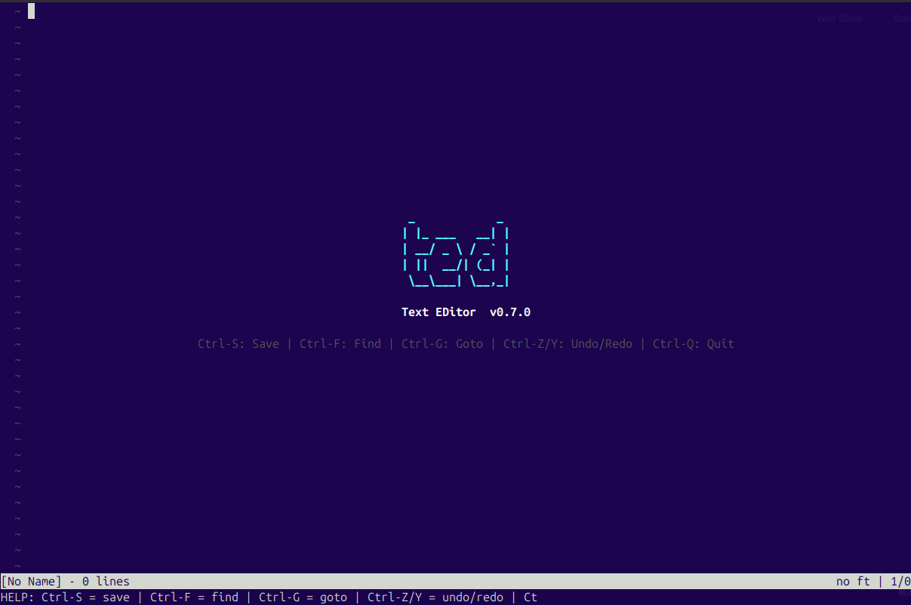

# ted — TinyEDitor

Minimal, zero-dependency terminal text editor written in C99 using raw `termios` input and ANSI escape sequences.

```text
  _            _
 | |_ ___   __| |
 | __/ _ \ / _` |
 | ||  __/| (_| |
  \__\___| \__,_|

TinyEDitor  v0.8.1
```

## Features
- **Zero External Dependencies**:<br/>Built purely on standard C99 and POSIX (termios, ioctl, sigaction)—no ncurses or third-party libraries required.<br/>
- **Runtime Configuration (`~/.tedrc` & `Ctrl-R`)**:<br/>Customize tab width, auto-indentation, line numbers, quit confirmations, and ANSI syntax colors via `~/.tedrc` or `$XDG_CONFIG_HOME/ted/tedrc`, and reload changes live with `Ctrl-R`.<br/>
- **XTerm SGR Mouse Support**:<br/>Click anywhere in the text viewport to position the cursor (with full tab-stop and gutter awareness) and scroll smoothly using the mouse wheel.<br/>
- **C/C++ Syntax Highlighting**:<br/>Highlights keywords, preprocessor directives, primitive types, strings, character literals, numbers (decimal, float, hex), and single-line (`//`) or multi-line (`/* ... */`) comments for `.c`, `.h`, and `.cpp` files.<br/>
- **Matching Bracket Highlighting**:<br/>Automatically highlights matching `( )`, `[ ]`, and `{ }` delimiters under the cursor while ignoring brackets inside strings and comments.<br/>
- **Incremental Search (`Ctrl-F`)**:<br/>Searches the buffer live as you type, cycles forward/backward across matches with arrow keys, and restores your original cursor and scroll position on Esc.<br/>
- **Atomic Undo / Redo (`Ctrl-Z` / `Ctrl-Y`)**:<br/>Reverses and replays character edits, word deletions, line splits, and line joins while keeping dirty-buffer status synchronized with disk saves.<br/>
- **Smart Indentation & Soft Tabs**:<br/>Preserves leading indentation on Enter, adds an extra 4-space indent after `{`, and supports 4-space Tab alignment and Shift-Tab outdentation.<br/>
- **Dynamic Line-Number Gutter**:<br/>Scales automatically with total file line count.<br/>
- **Live Terminal Resizing**:<br/>Responds immediately to terminal window resizes via SIGWINCH.<br/>



### Building & Installation

#### Build from Source
```Bash
make
```
#### Run
```Bash
./ted [OPTION]... [FILE]
```

Options:

  - `-h`, `--help` — Display usage summary and keybinding reference
  - `-v`, `--version` — Display version information
  - -- — End option parsing (useful for opening filenames starting with -)

### System-Wide Installation
Installs the ted binary to `/usr/local/bin/ted` and the manpage to `/usr/local/share/man/man1/ted.1`:
```Bash
sudo make install
```

To uninstall:
```Bash
sudo make uninstall
```

View the manual page at any time with:
```Bash
man ted
```

## Architecture

Building a text editor in C comes down to three key upfront architectural decisions:

  - **UI Backend**
      > A terminal interface using raw ANSI escape sequences (like the classic kilo editor, under 1,000 lines of standard C with zero dependencies), an `ncurses` TUI, or a graphical window using SDL2 or GTK.
  
  `ted` does not depend on `libcurses`, `SDL2` or `GTK`, it directly emits ANSI escape sequences on the terminal and uses raw input.

  - **Buffer Data Structure**
      > An array of row structs (simplest for getting a working prototype on screen fast), a gap buffer (ideal for local cursor insertions), or a piece table / rope (best for large files and unlimited undo/redo).
  
  `ted` uses a dynamic array of line structs (`erow *row`), where each line owns two heap-allocated flat character arrays (`chars` and `render`) plus a parallel syntax-highlight byte array (`hl`).
      
  ***Memory Layout***
  ```text
  typedef struct erow {
      int idx;                // Line index in file
      int size;               // Length of raw chars
      int rsize;              // Length of rendered chars
      char *chars;            // Raw line buffer (allocated per line)
      char *render;           // Display buffer (tabs expanded to spaces)
      unsigned char *hl;      // Syntax highlight token ID per rendered byte
      int hl_open_comment;    // Multi-line comment state carried to next row
   } erow;
  ```
  
  - **Core Scope**
      > Starting with a minimal viable editor (raw mode input, viewport scrolling, file I/O, and search) versus designing upfront for syntax highlighting and multiple buffers.
  
  For `ted`'s current scope (source files up to tens of thousands of lines, live C syntax highlighting, and zero external dependencies), the array-of-`erows` design is the cleanest fit because line indexing, scrolling, and per-line syntax state map 1-to-1 to terminal rows.

### License

This project is open-source software licensed under the GNU General Public License v3.0 (GPLv3). See the [LICENSE](LICENSE) file for terms and conditions.

Copyright (C) k!M/pizslacker 2026
